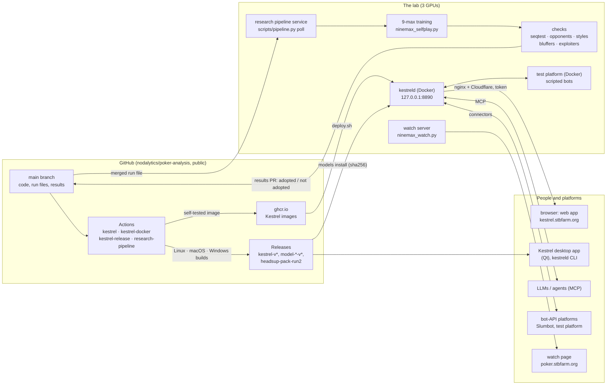
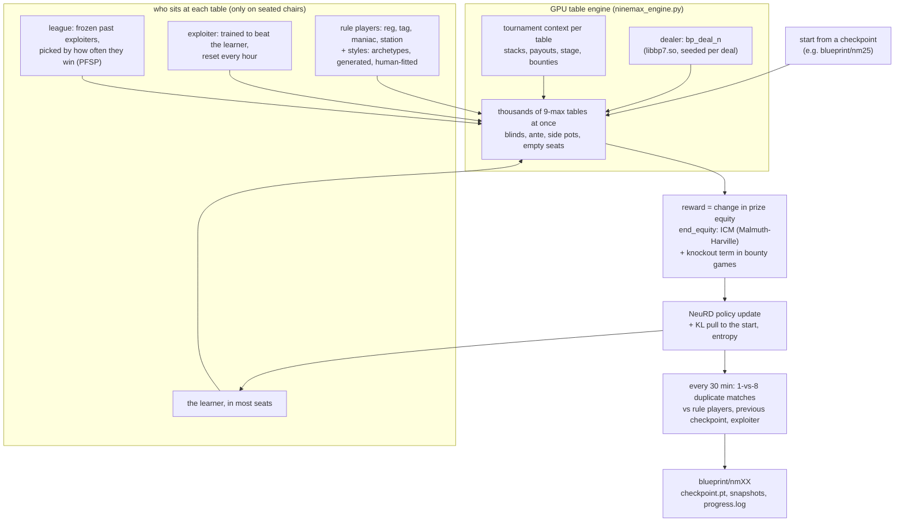
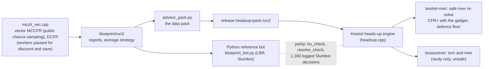
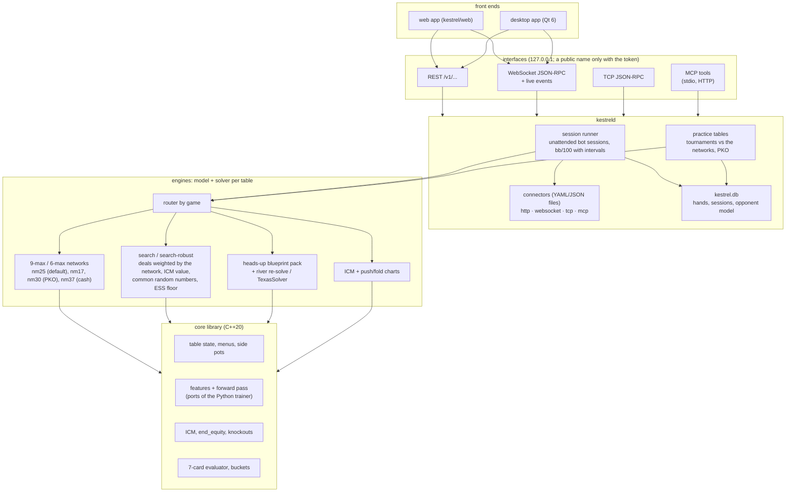
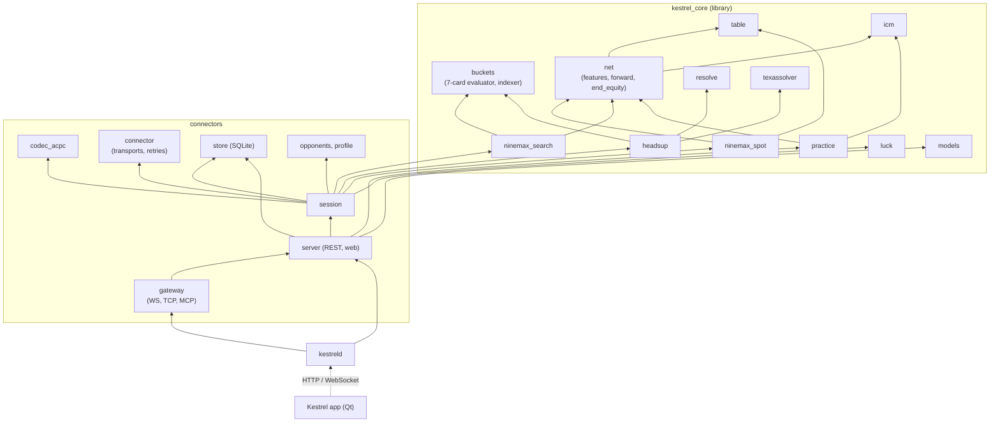
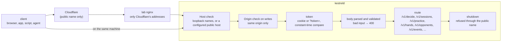
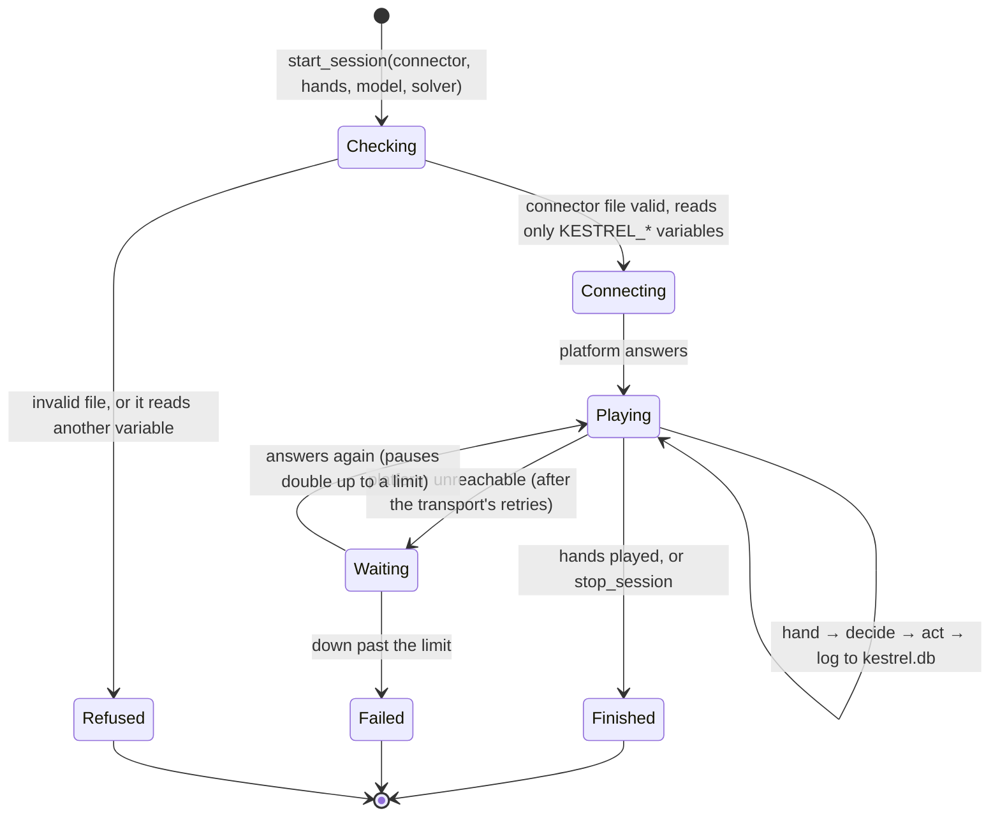
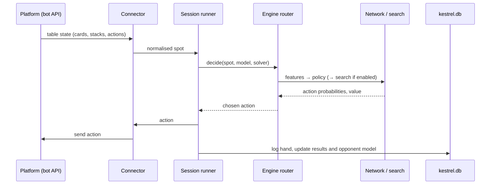
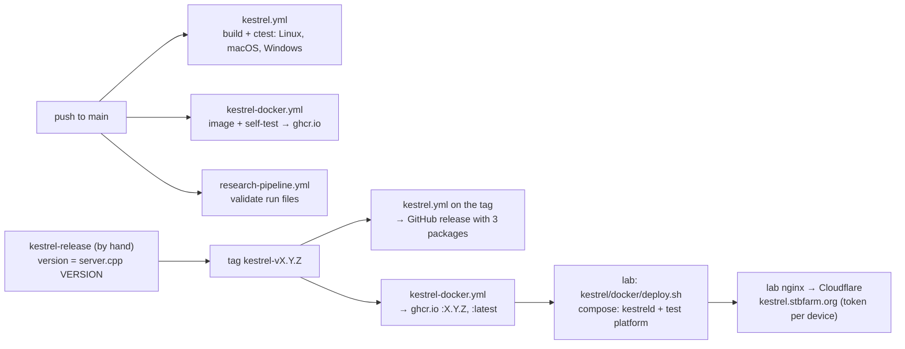

# Architecture

How the parts of this repository fit together: the research that trains the bots, the pipeline that judges and
ships them, Kestrel (the engine that plays and advises), and where each runs. The diagrams are Mermaid and render on
GitHub. Details live in the linked docs; this page is the map.

## 1. The whole system

- **Research** (`research/`) trains and measures the bots. Python with PyTorch on the GPUs, plus C++ CFR solvers.
- **The pipeline** turns a run file merged into `main` into a trained, judged network, with the checks fixed
  before training starts (`research/pipeline/README.md`).
- **Kestrel** (`kestrel/`) is the C++ engine that plays and advises with the adopted models. It is shipped as
  desktop packages and as a Docker image.
- **The lab** runs the training, the checks and the live Kestrel. GitHub only stores and builds; nothing on GitHub
  can send the lab a command (the lab reads `main` by itself).

## 2. Training a 9-max network

- The network (`NineNet`) reads the table as features: cards (bucketed by the abstraction in `blueprint/out`),
  positions, stacks, the betting, and the ICM context. It outputs a policy over the action menu and a value.
- Every chair an opponent takes must have a player in it, and each bust's bounty goes to whoever won the pot that
  took the player's last chips (fixes B1 and B2 in `research/docs/2026-11-23-review-and-plan.md`).

## 3. From a run file to Kestrel

```mermaid
flowchart LR
    RF["research/pipeline/runs/nmXX.json<br/>question, why, training, checks"]
    VAL["CI: pipeline.py validate"]
    MERGE["merged into main<br/>= the pre-registration"]
    POLL["lab: pipeline.py poll<br/>(every 2 min, needs 25 GB free)"]
    TR["train<br/>(minutes, GPU, args, opponents)"]
    CK["checks, all must pass"]
    PR["PR: nmXX adopted / not adopted<br/>results/pipeline/nmXX, prereg result"]
    GATE["model_pipeline.py gate<br/>poker-sense, push/fold, match vs champion,<br/>Kestrel C++ self-test"]
    PKG["package: .tar.gz + .sha256"]
    PUB["publish: GitHub release model-NAME-vV<br/>+ research/models/manifest.json"]
    INST["kestreld models install"]

    RF --> VAL --> MERGE --> POLL --> TR --> CK --> PR
    PR -- "adopted" --> GATE --> PKG --> PUB --> INST
```

The checks a run can carry (`research/pipeline/README.md`):

| Check | Asks |
|---|---|
| `seqtest` | does it lose to the champion (sequential duplicate match)? |
| `opponents` | against rule players, is it within a tolerance of the baseline (paired, with an interval rule)? |
| `styles` | across generated and archetype players, worst case and average? |
| `bluffers` | do scripted bluff jams and raises lose against it? |
| `exploit` / `exploiters` | how much can a learner trained to beat it win (mean over seeds)? |
| `patterns` | do the patterns people found against the bot still win? |
| `consistency`, `opponent-model` | reports for the reviewer, not gates |

## 4. The heads-up route

Off-tree bets (sizes the abstraction doesn't have) map to a nearby abstract action. The draw is fixed per hand, so a
replay of the same hand maps the same way. TexasSolver gets the effective stack (the smaller of the two).

## 5. Inside Kestrel

- **Parity with the trainer.** The core is a port of the Python engine. `kestrel_selftest` replays the Python
  reference's vectors (features, logits, values, payoffs, ICM, search, heads-up decisions) to within tolerance.
  A build that fails it is not packaged.
- **Connector files are untrusted.** They may read only `KESTREL_*` environment variables, and `kestreld check`
  shows the hosts and variables a file uses before it runs.
- **No real-money play.** Kestrel has no screen reading or clicking, and no connector for a real-money site.

### 5.1 Kestrel's source map

| Layer | Files (`kestrel/`) | Role |
|---|---|---|
| **core** (library, no I/O) | `core/src/table.cpp` | one table's state: blinds, antes, menus, legality, side pots, payoffs |
| | `net.cpp` | the 9-max network: features, forward pass (AVX2/FMA), `end_equity` with the knockout rule |
| | `icm.cpp` | ICM (Malmuth-Harville and Malmuth-Weitzman), start equity |
| | `ninemax_spot.cpp` | a platform's 2-9 handed spot replayed into Kestrel's table, and the answer turned back into its chips |
| | `ninemax_search.cpp` | search at play time: weighted deals, rollouts, CRN, the ESS floor |
| | `headsup.cpp`, `buckets.cpp` | the heads-up blueprint walk, off-tree mapping, card buckets |
| | `resolve.cpp`, `texassolver.cpp` | the safe river re-solve; TexasSolver as an external program (time-limited) |
| | `practice.cpp` | practice tournaments: stacks carry over, blinds rise, places and bounties paid |
| | `luck.cpp` | luck-adjusted heads-up results (AIVAT-style corrections) |
| | `models.cpp` | installed model packages, each file checked against its sha256 |
| **connectors** (I/O) | `connectors/src/server.cpp` | the REST API and web app: Host/Origin checks, token, routes, version |
| | `gateway.cpp` | the same methods over WebSocket, TCP and MCP, each a front door to REST |
| | `connector.cpp`, `codec_acpc.cpp` | connector files, transports with retries, the ACPC and structured codecs |
| | `session.cpp` | the session runner: plays N hands, waits out outages, logs every hand |
| | `store.cpp` | `kestrel.db` (SQLite): sessions, hands, opponents, spots |
| | `opponents.cpp`, `profile.cpp` | opponent statistics, and profiles compared to player types by cosine similarity |
| **programs** | `tools/kestreld.cpp` | the daemon and CLI: `serve`, `play`, `check`, `sessions`, `stats`, `import`, `models install/list/verify`, `mcp` |
| | `app/` | the Qt 6 desktop app, a client of `kestreld` |
| | `web/index.html` | the web app `kestreld` serves |
| **tests** | `tools/selftest.cpp`, `hu_check.cpp`, `resolve_check.cpp`, `search_check.cpp`, `server_check.sh` | parity with the Python reference, heads-up, re-solve, search, server |
| **deployment** | `Dockerfile`, `docker/` (compose, deploy, nginx), `testplatform/`, `packaging/` | the image, the lab's compose with the test platform, desktop install |

### 5.2 How the modules depend on each other

### 5.3 A request's path, and the checks on it

The server binds `127.0.0.1` only. Another machine reaches it through an SSH tunnel, or through the public name, which
is served only with the token. Inside Docker every request comes from the Docker network, so every visitor needs the
token there.

### 5.4 Data Kestrel keeps

| Where | What |
|---|---|
| `kestrel.db` (SQLite) | `sessions`, `hands` (key columns plus the whole record as JSON), `opponents` (statistics by platform and name), `spots`, `meta` |
| `hands.jsonl` | the same hands as lines, an export |
| `settings.json` | defaults: model, solver, search samples, TexasSolver path and limits |
| `models/` | installed packages (`ninemax/<name>/`: `model.json`, `net.bin`, test vectors), each file sha256-checked |
| the heads-up pack | the blueprint data from the `headsup-pack-run2` release |
| the token | created on first start; in Docker, all of the above live in the `kestrel-data` volume |

### 5.5 A bot session's life

## 6. One decision, end to end

## 7. Build, release and deployment

The tests every build runs (`ctest`):

| Test | Covers |
|---|---|
| `selftest` | 9-max parity with the Python trainer (nm17), ICM, heads-up decisions |
| `hu_check` | heads-up: stable off-tree mapping, TexasSolver's effective stack, the floor switch |
| `server_check` | the HTTP server: Host/Origin checks, token, malformed input, public-host shutdown refusal |
| `selftest_pko` | bounty features and equity (nm30); practice PKO tournaments add up |
| `selftest_cash6` | 6-max cash (nm37) |
| `search_check` | search scoring, common random numbers, the ESS floor |

## Where to read more

| Topic | Doc |
|---|---|
| Kestrel's design, interfaces, connectors, search | [`kestrel/docs/design.md`](../kestrel/docs/design.md), [`kestrel/README.md`](../kestrel/README.md) |
| The pipeline and its checks | [`research/pipeline/README.md`](../research/pipeline/README.md) |
| Models and the manifest | [`research/models/README.md`](../research/models/README.md) |
| The heads-up solvers and re-solving | [`research/blueprint/model.md`](../research/blueprint/model.md) |
| The current plan, fixes and results | [`research/docs/2026-11-23-review-and-plan.md`](../research/docs/2026-11-23-review-and-plan.md) |
| Rules for working in the repo and on the lab | [`research/AGENTS.md`](../research/AGENTS.md) |
