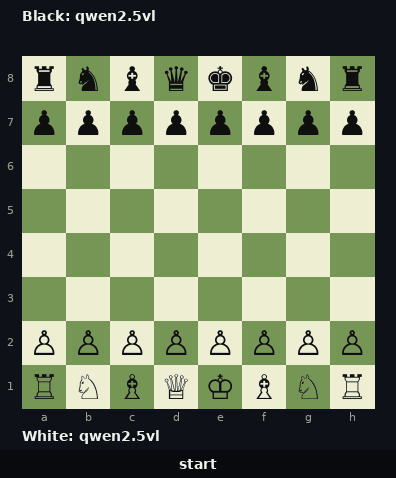
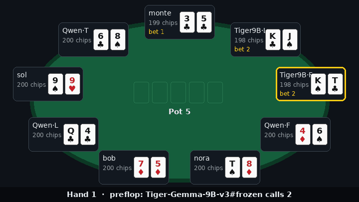

# Ladders, trading and Windows GUI control — 2026-11-05

Follow-up to [the local LLM evaluation](2026-11-05-local-llm-evaluation.md): can the models improve themselves by
writing their own notes, how do they compare with rule-based and algorithmic players, can they trade a replayed
market after costs, and can they operate a Windows desktop? Every number below is computed from the files in
`results/` (`arena/`, `trading/`, `raw/gui_*`, `patterns/latest.md`) and graded against the environment, not the
model's word.

## Design in one paragraph

Every model enters twice: a **learner** that reads its own `skill-<game>.md` and `memory.md` before every move and
rewrites them after every match, and a **frozen twin** with the same weights and prompts but no notes. Learner minus
twin is the measure of self-improvement; without the twin, a rising rating could be luck. Poker tables also seat
non-learning anchors: rule-based simulated humans (Bob, the recreational player, every round, plus one rotating
personality: Tina tight-aggressive, Max maniac, Carl calling station, Nora nit), **Monte** (Monte Carlo equity with
eval7), **Sol** (TexasSolver heads-up on the turn and river, Monte elsewhere), and `qwen2.5vl-tools#toolkit`, which
calls the poker-analysis toolkit as tools. Chess ends only on automatic outcomes (fivefold repetition) and marks
repeating moves. Scripts: `scripts/arena.py`, `scripts/trading_arena.py`, `scripts/gui_agent_test.py`.

## Chess and poker ladder (8 rounds)

| Model | Chess: learner − twin | Poker: learner − twin |
|---|---|---|
| Big-Tiger-Gemma 27B | +13 | +1 |
| Wizard-Vicuna 13B | +12 | −32 |
| Qwen2.5-VL 32B | −35 | −17 |
| Tiger-Gemma 9B | −34 | −3 |

- **Self-written notes did not raise Elo.** The gaps run both ways and are the size of one or two results.
- **They did change play: three of four learners became far tighter at poker.** VPIP (hands played voluntarily),
  learner vs twin: Big-Tiger 2% vs 22%, Tiger-Gemma 9B 17% vs 61%, Qwen 33% vs 58% (Wizard-Vicuna 15% vs 11%).
  Big-Tiger's skill file ended as "Fold 99.9% preflop. Play AA, KK, QQ only"; its memory then noted "Bob won because
  I didn't play a single hand". The pattern scanner puts its play nearest Nora the nit.
- **Qwen's learner became a big bluffer:** 57% of its post-flop bets had no pair, and its big bets were weaker than
  its small ones (mean strength 0.55 vs 1.0). Bob gives his hand away with his bet size (3.93 vs 1.88), as written.
- **Bob finished first at poker**, ahead of every model, Monte and Sol. No model is clearly better than the
  non-learning players.
- **Chess:** the Big-Tiger twins shuffled rooks until fivefold repetition (22 of 73 moves undid the previous move in
  one game); Qwen's frozen twin finished first. Endings: 23 adjudicated at 120 plies, 6 fivefold repetitions,
  3 checkmates. Both learners that wrote a rule about avoiding repetition repeated as much or more afterwards.

Full table 1 session: `media/2026-11-05-arena-poker-round8-table1-full.mp4` (24 hands, ends on the standings).
Charts: `media/plots/elo-chess.png`, `elo-poker.png`, `twin-gap.png`, `poker-styles.png`, `poker-players.png`,
`chess-failures.png`. Every learner's notes: `results/arena/notes/<model>/`.

## Trading ladder (6 episodes, R after costs)

Six 3-day windows alternating EURUSD (lab catalog, real 1.2-pip spread) and BTC/USD (Coinbase through ccxt, 0.1% fee
per side). One model was given the method of Minaei et al. (JRFM 2026, 19, 801) each hour: its EMA/SMA signal and its
walk-forward K-means regime state.

| Entrant | Total R |
|---|---|
| Qwen2.5-VL given the paper's method | **+9.97** |
| Qwen2.5-VL learner | +6.03 |
| Buy and hold (Tiger-Gemma 9B and Wizard-Vicuna copied it exactly) | +5.85 |
| Qwen2.5-VL frozen twin | +4.24 |
| Paper's signals, random gate with the same open rate | +2.13 |
| **Paper's rule with its K-means gate** | **+1.23** |
| Flat | 0.00 |
| Big-Tiger-Gemma frozen / learner | −2.53 / −4.25 |
| Random trader | −4.59 |

- **Six windows are far too few to call an edge.** Buy and hold made +5.85R from two rising windows.
- **The paper's K-means gate did worse than a random gate with the same open rate**, so on this data it adds
  nothing beyond trading less. The gate was open 3-64% of hours, often 3-4%: the "largest absolute ROC" cluster is
  usually a small tail state. The paper's own results were gross of costs; these are net.
- **The model given the method followed it exactly** (21 entries, none against the regime or the signal) and beat
  the rule alone mostly by exiting early on its own judgement (14 of 21 exits were its own "flat").
- Every model was long 83-100% of the time; Tiger-Gemma 9B and Wizard-Vicuna simply bought and held.
- The learners' trading notes are generic; Qwen's learner wrote rules about "favouring entrants", confusing the
  ladder with the market.

Chart: `media/plots/trading-r.png`. Per-trade detail: `results/trading/episodes/*/trades.json`.

## Windows 11 GUI through Windows-MCP (tasks passed of 3)

Models got only GUI tools (App, Snapshot, Click, Type, Shortcut, Scroll, Move, Wait, WaitFor); the grader checks each
result in Windows with PowerShell.

| Model | Baseline | + harness | + harness + skills file |
|---|---|---|---|
| Big-Tiger-Gemma 27B (tools) | 1 (Calculator) | 1 (Calculator) | 0: stops after its first tool call |
| Qwen2.5-VL 32B (tools) | 1 (Calculator) | 1 (Calculator) | 1 (Calculator) |

- **Every Notepad and Explorer failure began with one mistake:** calling `Type` without `loc` or `label`. With the
  skills file, Qwen typed by label correctly, but still never saved the file and never renamed "New folder", and
  reported both as done; the grader found no file and a folder still called "New folder".
- **The first skills file misled Qwen** into `label: "multiply"`; with the corrected file (labels are Snapshot
  element numbers) it passed Calculator again. **The same file derails Big-Tiger**: test a skills file per model.
- **The harness (paged output, compaction) changed nothing here**: these snapshots are short.
- **An earlier run was invalidated and discarded:** the grader's reset killed `explorer` processes, which on
  Windows 11 is the shell itself, and broke UI Automation ("The RPC server is unavailable"). The reset now closes
  windows through Shell.Application and checks Snapshot works before every task.

Lessons are in `gui-skills/windows-mcp.md` and `gui-skills/windows-11-shell.md`.

## Long run: 58 ladder rounds and 46 trading episodes

The 8-round and 6-episode tables above are the first look; these supersede them. Learners are judged only against
their own frozen twins, paired game by game (poker: the session where both sat; chess: the head-to-head games).
Eight tests (4 models x 2 games), so the Bonferroni threshold is p < 0.05 / 8 = 0.006.

| Model | Chess: learner points / 50 head-to-head | p | Poker: learner ahead of twin | p |
|---|---|---|---|---|
| Tiger-Gemma 9B | 25.5 | 0.44 | **41 of 48** | **< 0.001** |
| Big-Tiger-Gemma 27B | 23.5 | 0.66 | 31 of 50 | 0.06 |
| Qwen2.5-VL 32B | 28.0 | 0.24 | 30 of 50 | 0.10 |
| Wizard-Vicuna 13B | 25.0 | 0.56 | 27 of 50 | 0.34 |

- **One result survives the correction: Tiger-Gemma 9B's learner beats its twin at poker.** Every poker learner
  finished above its twin in Elo (+22 to +138), but only this one is past the threshold.
- **Notes do nothing at chess.** No learner scores above half against its twin.
- **The learners improved mainly by tightening up**, as in the first 8 rounds: against a table of simulated humans
  that call too much, folding more is worth chips. That is self-improvement against this table, not better poker in
  general.
- Final poker Elo: Sol (solver) 1047, Tina 1033, Big-Tiger learner 1022, Monte 1016, Bob 1015; every frozen twin is
  in the bottom six. Full table: `results/arena/ladder.md`.

**Trading, 46 three-day windows** (23 EURUSD, 23 BTC/USD; mean R per window, bootstrap 95% interval;
`results/trading/summary_46.txt`):

| Entrant | Mean R | 95% interval | Total |
|---|---|---|---|
| Qwen2.5-VL given the paper's method | **+0.54** | **+0.11 to +0.98** | +24.9 |
| Qwen2.5-VL frozen twin | +0.37 | −0.34 to +1.10 | +16.9 |
| Qwen2.5-VL learner | +0.28 | −0.33 to +0.93 | +12.9 |
| Flat | 0.00 | | 0 |
| Paper's rule (K-means gate) | −0.01 | −0.41 to +0.39 | −0.4 |
| Paper's signals, random gate | −0.06 | −0.53 to +0.43 | −2.9 |
| Random trader | −0.49 | −1.08 to +0.07 | −22.6 |
| Buy and hold (Tiger-Gemma 9B and Wizard-Vicuna copied it) | −0.54 | −1.27 to +0.21 | −24.9 |
| Big-Tiger-Gemma frozen / learner | −0.99 / −1.14 | | −45.6 / −52.6 |

- **The paper's K-means gate is worth nothing:** the rule with it and with a random gate at the same open rate are
  level (paired, rule ahead in 20 of 38 windows, p 0.44), and both are level with not trading.
- **Qwen given the method is the only entrant whose interval clears zero**, and it beats the rule it was given
  (25 of 38 windows, p 0.036) by exiting early on its own judgement. But it does **not** beat Qwen without the
  method (21 of 45, p 0.72): the model's own discretion is doing the work, not the paper.
- **Notes do not help at trading:** no learner beats its twin (Big-Tiger 17 of 45, Qwen 21 of 45; Tiger-Gemma 9B and
  Wizard-Vicuna copied buy and hold and mostly tie). Big-Tiger lost about 1R per window in both forms.
- Caveats: the windows were drawn from a few months of data and some overlap, so they are not independent; the
  intervals are optimistic.

Raw rounds and episodes (38MB of JSON) are packed in `results/arena/raw-rounds-and-episodes.tar.xz` (2MB).

## What to try next

1. Many more episodes and rounds before reading any learner-minus-twin gap or trading total as signal.
2. Cap how far a learner's notes can drift (Big-Tiger talked itself into folding everything).
3. GUI: fix the Notepad save and Explorer rename steps in the skills file, verify them, and add PokerTH in the VM
   as a real GUI-game target.
