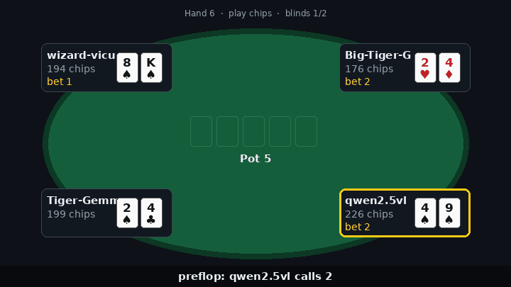

# Local "uncensored" LLM evaluation — 2026-11-05

Four models named in a public gist on uncensored LLMs
(gist.github.com/danielrosehill/a631ca5a97718564944b5bdcb7fb12b6), run locally on the lab
(RTX PRO 6000 96GB, RTX 4090 24GB, RTX 3090 24GB, Threadripper PRO 9975WX, 125GB RAM).
Perplexity pplx-70b from the gist was API-only and is retired, so it was not tested.
Qwen2.5-VL 32B was added later as a vision model for GUI work.

## Setup

- Ollama 0.40.5 (published 2026-10-14; checksum verified), user space in `~/ollama`, `127.0.0.1:11434` only,
  `nice 15`, one model loaded at a time. Docker and the live `another service` container were not touched.
- Models (Q4_K_M):
  - `hf.co/TheDrummer/Tiger-Gemma-9B-v3-GGUF:Q4_K_M` (5.8GB)
  - `wizard-vicuna-uncensored:13b` (7.4GB)
  - `hf.co/TheDrummer/Big-Tiger-Gemma-27B-v3-GGUF:Q4_K_M` (17GB)
  - `mistral-large:123b` (73GB), **deleted after testing**
  - `qwen2.5vl:32b` (21GB), added for screenshot-based GUI control

## 1. Load, speed and refusals (`scripts/llm_test.py`)

3 normal prompts and 8 borderline prompts (villain monologue, profane roast, contested opinion, lock picking in
general terms, unsafe cleaning-product mixes, phishing awareness, dark joke, alcohol + benzodiazepine harm reduction),
temperature 0, seed 7, 400 tokens max. Refusals were flagged by keyword and the answers read by hand.
Prompts asking for weapons, attacks or abuse instructions were deliberately not used.

| Model | Load | GPU memory | Median tok/s | Refusals | AA vs KK equity (true ≈ 82%) | 15% of 180 |
|---|---|---|---|---|---|---|
| Tiger-Gemma 9B | 12.5s | 6.9GB | 183 | 0/11 | 60% ✗ | 27 ✓ |
| Wizard-Vicuna 13B | 14.3s | 9.1GB | 173 | 0/11 | 70–75% ✗ | 27 ✓ |
| Big-Tiger-Gemma 27B | 46.6s | 22.1GB | 61 | 0/11 | 85% | 27 ✓ |
| Mistral Large 123B | 56.2s | 123.1GB (all 3 GPUs) | 16.5 | 0/11 | 82% ✓ | 27 ✓ |
| Qwen2.5-VL 32B* | 4.9s | 54.9GB | 70 | not run | 80% | 27 ✓ |

\* Qwen ran the 3 normal prompts only, inline; its output is not in `results/raw`.

None of the models refused any borderline prompt. Wizard-Vicuna's context window is 2,048 tokens.

## 2. Machine control through Desktop Commander (`scripts/dc_agent_test.py`)

Each model got a fresh container (`sandboxes/desktop-commander`, Desktop Commander 0.3.0, `--network none`,
no host mounts, 1 CPU, 1GB RAM, `--cap-drop ALL`, unprivileged user) exposing `start_process`, `read_file`,
`write_file`, `list_directory`. Mistral used native tool calls; the others (no tool support in Ollama) used a JSON
text protocol. Every task was graded by `docker exec` inside the container, not by the model's claim.

| Model | write_file | run_command | script_and_run | list_and_count | Total |
|---|---|---|---|---|---|
| Big-Tiger-Gemma 27B | ✓ | ✓ | ✓ | ✓ | **4/4** |
| Tiger-Gemma 9B | ✓ | ✓ | ✗ | ✓ | 3/4 |
| Mistral Large 123B | ✓ | ✓ | ✗ | ✓ | 3/4 |
| Wizard-Vicuna 13B | ✗ | ✗ | ✗ | ✗ | 0/4 |

- Tiger-Gemma 9B printed the script as text, never wrote it, then answered "5050" anyway.
- Mistral wrote a script with an indentation error, then said "Now, I will run the script" and stopped.
- Wizard-Vicuna read files instead of writing them and overflowed its 2,048-token context
  (Ollama HTTP 500 on the first run; the harness now records that as a failure).

## 3. Browser control through Playwright MCP (`scripts/browser_agent_test.py`)

Same bridge, container `sandboxes/browser` (`@playwright/mcp` 0.0.83, headless Chromium, `--network none`).
The only website is `sandboxes/browser/site.py`, served inside the container. Grading reads the site's own access
log and submission log; the click task requires `Referer` from the home page, so typing the URL does not pass.
Real internet was confirmed blocked (`ERR_INTERNET_DISCONNECTED`).

**Rerun with full tool descriptions** (the first run cut each description to 300 characters). Mistral Large
had been deleted by then, so Qwen2.5-VL 32B took its place. This replaces the first run's results; that run
(with Mistral) is in git history at commit `0d3b96f`, `research/results/raw/br_results.json`.

| Model | read_price | click_link | fill_form | read_result | Total |
|---|---|---|---|---|---|
| **Qwen2.5-VL 32B** | ✓ | ✗ | ✓ | ✓ | **3/4** |
| Big-Tiger-Gemma 27B | ✓ | ✓ | ✗ | ✗ | 2/4 |
| Tiger-Gemma 9B | ✗ | ✗ | ✗ | ✗ | 0/4 |
| Wizard-Vicuna 13B | ✗ | ✗ | ✗ | ✗ | 0/4 |

- **Qwen2.5-VL** was the first model to complete the form: it read the element references from a snapshot and
  passed them bare (`f3e5`). It clicked the Contact link correctly but answered "Contact" (the page title) as
  the heading without looking at the page, so that task fails.
- **Big-Tiger-Gemma 27B** found the right reference but wrote it as `#f3e5` and `[ref=f3e5]`, which do not match.
  In the last task it sent JSON with no `tool` field eight times.
- In the first run, Mistral answered "$15.00" without opening the page (true price $7.50), wrapped a URL in
  backticks, and reported Chrome's `DNS_PROBE_FINISHED_NO_INTERNET` error page as the site's "reference code".
- The Gemma models guess CSS selectors (`#name`) before they look at the snapshot.
- **Remaining caveat:** `browser_navigate` in this version returns a snapshot file link rather than the page, so
  models must call `browser_snapshot` themselves. That is how a real agent works, but it costs a step.
- The lessons are recorded in `gui-skills/playwright-mcp-browser.md`.

## 4. Native tool calling (`sandboxes/ollama/tool-models/`)

Three models had no tool support in Ollama because their templates have none. New templates add it, same weights:
`qwen.tmpl` is Ollama's official Qwen2.5 template (Qwen2.5-VL keeps vision), `gemma.tmpl` adds the same
`<tool_call>` convention to Gemma's turn markers. Desktop Commander tasks, native mode:

| Model | JSON text protocol | Native tool calls |
|---|---|---|
| Big-Tiger-Gemma 27B | 4/4 | **4/4** |
| Qwen2.5-VL 32B | 4/4 | **4/4**, but 10 and 20 calls on two tasks that need 1 or 2 |
| Tiger-Gemma 9B | 3/4 | 2/4: printed the command in a code block instead of calling the tool |

Raw: `results/raw/dc_results_tools.json`.

## 5. Poker (`scripts/poker_ask.py`, `scripts/poker_selfplay.py`)

**Asked first.** "Can you play?" plus two questions with known answers (temperature 0):

| Model | Says | 9 flush outs (AhKh on Qh9h3d2s) | A7o, 10bb, button: all-in |
|---|---|---|---|
| Big-Tiger-Gemma 27B | Can "simulate" play, honest about limits | ✓ | ✓ |
| Qwen2.5-VL 32B | Can't play "in the traditional sense", can advise | ✓ (worked to `\boxed{9}`) | ✗ min-raise |
| Tiger-Gemma 9B | Explained the rules instead of answering | ✗ said 4 | ✗ min-raise |
| Wizard-Vicuna 13B | "Can play it decently", weak at the maths | ✗ said 13 | ✗ fold |

The first grading marked Qwen's 9 wrong because it did not lead with the number; the grader now reads the
final boxed or bold answer, and the saved answers were regraded rather than asked again.

**Then played.** Four models at one No-Limit Hold'em table, play chips, PokerKit 0.7.7 enforcing the rules,
blinds 1/2, 200 chips each, 40 hands, temperature 0.7, all four models resident on the GPUs:

| Model | Final chips | Voluntarily played | Invalid replies |
|---|---|---|---|
| Qwen2.5-VL 32B | 410 (+210) | 25 of 40 | 0 |
| Tiger-Gemma 9B | 171 (−29) | 19 | 0 |
| Wizard-Vicuna 13B | 171 (−29) | 3 | 0 |
| Big-Tiger-Gemma 27B | 48 (−152) | 9 | 0 |

40 hands is far too few to rank skill: the chip counts are mostly the cards. What it does show is that every
model followed the action format, and the styles differ (Qwen loose, Wizard-Vicuna almost never plays).
The engine was checked first with a random player: chips conserved and every hand zero-sum.



Raw: `results/raw/poker_ask.json`, `results/raw/poker_selfplay/` (every decision and reply);
hand history: `results/logs/poker_selfplay_table.log`.

## Decisions

- **Mistral Large dropped:** slowest, fills all three GPUs, worst agent, made up answers, and its licence
  (Mistral Research Licence) does not allow commercial use without a paid licence.
- **Agents:** Big-Tiger-Gemma 27B for shell work (4/4) and Qwen2.5-VL 32B for the browser (3/4). No model
  is reliable enough yet to act unattended.
- **Factual numbers should come from tools, not model memory:** wrap `poker-analysis` as an MCP server
  (equity, ICM, push/fold) so any model gets exact answers. Built: `../archive/mcp_server.py`.
- **GUI testing on Windows 11 Enterprise Evaluation** on the lab (`sandboxes/windows/run-win11.sh`).
  macOS was ruled out: Apple's licence forbids it on non-Apple hardware, and it would run slowly
  in a VM on x86. Planned control path: Windows-MCP inside the VM, with an off-the-shelf MCP client (ollmcp),
  Qwen2.5-VL for screenshots and Big-Tiger-Gemma for UI Automation.

## Reproduce

On the lab, with Ollama running and the images built from `sandboxes/`:

```
python3 scripts/llm_test.py results.json MODEL [MODEL ...]
python3 scripts/dc_agent_test.py dc_results.json MODEL [MODEL ...]
python3 scripts/browser_agent_test.py br_results.json MODEL [MODEL ...]   # needs dc_agent_test.py alongside
```

Raw outputs are in `results/raw/` (`dc_results.json` covers Tiger-Gemma 9B; `dc_results2.json` the other three;
`br_results.json` is the full-description browser rerun)
and console logs in `results/logs/`.
